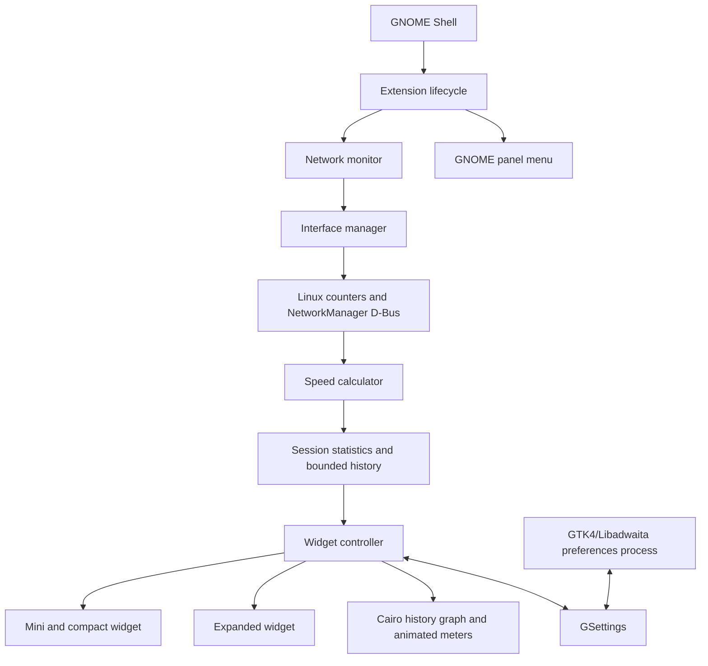
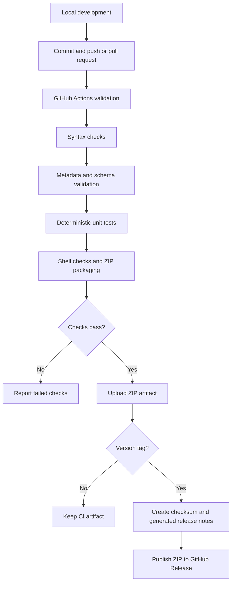

# Architecture

Uthy Speed Glass is a GNOME Shell ES-module extension. The Shell runtime owns the floating St actors and one GLib sampling source. `prefs.js` is launched separately by GNOME and uses only GTK4, Libadwaita, Gio, and GLib; it never imports Shell, St, Meta, or Clutter.

## Component architecture



## Data pipeline

```mermaid
flowchart TD
    A[Selected network interface] --> B[/proc/net/dev RX and TX counters]
    B --> C[Counter pair plus monotonic timestamp]
    C --> D{Baseline exists and sample is valid?}
    D -->|No| E[Set baseline; report initializing or disconnected]
    D -->|Yes| F[Counter deltas divided by elapsed seconds]
    F --> G[Decimal MB/s: bytes per second / 1,000,000]
    G --> H[Bounded history, averages, peaks and byte totals]
    E --> I[Widget state and honest unavailable values]
    H --> I
    I --> J[St widget, meters, labels, Cairo graph]
```

## GitHub CI/CD pipeline



The workflow is defined in `.github/workflows/validate.yml` and runs validation for pushes and pull requests. A matching `vMAJOR.MINOR.PATCH` tag publishes the installable ZIP, full-source ZIP, and checksums only after the validation job succeeds. The public source repository is [uthumany/uthy-speed-glass](https://github.com/uthumany/uthy-speed-glass).

## Modules and responsibilities

- `extension.js`: creates settings and services; connects the widget, panel menu, and monitoring lifecycle; removes all extension-owned resources on disable.
- `src/network/trafficReader.js`: pure parsers for `/proc/net/dev` and `/proc/net/route`; validates interface names.
- `src/network/interfaceManager.js`: enumerates kernel counters, reads link state, uses NetworkManager's system D-Bus active connection metadata when available, then falls back to route and sysfs observations.
- `src/network/speedCalculator.js`: monotonic elapsed-time calculations, decimal units, interface/counter reset handling, and fresh baselines.
- `src/network/statistics.js`: session RX/TX totals, sample averages, peaks, and unit formatting.
- `src/network/pingMonitor.js`: optional local gateway ping via `Gio.Subprocess`, with a numeric-address argument, a timeout, and no shell.
- `src/network/networkMonitor.js`: one refresh timeout, recovery states, bounded history (120 entries), optional ping scheduling, and service teardown.
- `src/settings/settingsManager.js`: validates values read by the UI and bounds values written by geometry changes.
- `src/ui/widgetController.js`: presentation states, panel/widget actions, mode composition, styling, and geometry.
- `src/ui/miniWidget.js`, `expandedWidget.js`, `speedGauge.js`, `historyGraph.js`: rendering and presentation updates.
- `src/ui/dragController.js`: pointer movement/resizing, geometry persistence, and monitor clamping.
- `prefs.js`: GTK4/Libadwaita control panel; settings synchronize through GSettings in a separate process.

## Measurement and data dependency

The reader treats `/proc/net/dev` as the source of RX/TX bytes. A sample stores the interface name, both counters, and `GLib.get_monotonic_time()`. Rates use `delta / elapsed / 1,000,000`; no internet test, remote API, or telemetry is involved. If the chosen interface is absent, the display reports disconnected. If the baseline is new, the interface changes, a counter moves backward, time is invalid, or the sample gap exceeds 30 seconds, a new baseline is recorded and no artificial spike is displayed.

NetworkManager metadata is best-effort and local D-Bus only. If the service is unavailable or its metadata differs, the reader falls back to the active IPv4 default route, `/sys/class/net/*/operstate`, and the interface counters. Manual selection remains possible for all visible non-loopback interfaces. The ping helper currently discovers only an IPv4 gateway from `/proc/net/route`; IPv6 traffic counters can still be read per interface, but IPv6-only ping discovery is not implemented.

## State transitions

Monitoring state is one of `INITIALIZING`, `CONNECTED`, `DISCONNECTED`, `PAUSED`, `ERROR`, or `DISABLED`.

- Startup enters `INITIALIZING`; an interface plus its first counters create a baseline. The next valid sample enters `CONNECTED`.
- Missing interface/counters enters `DISCONNECTED` and clears the old baseline. Reconnection starts at `INITIALIZING` before a rate is shown.
- Pause removes the sampling source, stops an in-flight ping, and enters `PAUSED`. Resume creates a fresh baseline.
- Counter or runtime exceptions enter `ERROR`; the timeout remains owned and later ticks retry. Disable removes the timeout, ping callbacks/processes, UI actors, signal connections, and stylesheet, then enters `DISABLED`.

Presentation state is one of `MINI`, `EXPANDED`, `MINIMIZED`, or `HIDDEN`. `MINI` and `COMPACT` share the concise readings composition; `EXPANDED` adds meters, graphs, statistics, interface selection, pause/reset, and preferences. `MINIMIZED` retains both readings in the mini composition. `HIDDEN` hides the actor but leaves the extension active and recoverable from the panel menu.

## Failure paths and cleanup

- No `/proc/net/dev` entry or missing interface: clear rate and show disconnected; keep sampling.
- NetworkManager D-Bus absent: mark the integration unavailable and use kernel route/sysfs fallback.
- Invalid persisted strings or geometry: validate names/colors/modes and clamp allowed numeric ranges before use.
- Missing `ping` binary, gateway, timeout, or process error: show ping unavailable only; throughput sampling continues.
- Counter reset, interface change, invalid/zero elapsed time, or suspend gap: reset baseline without a spike.
- Widget moved/resized off-screen: clamp to the selected monitor; monitor changes re-clamp.
- Extension disable: remove every GLib source, signal, subprocess, actor, and loaded stylesheet before dropping references.

## Settings and package boundaries

Schema ID: `org.gnome.shell.extensions.uthyspeedglass`; path: `/org/gnome/shell/extensions/uthyspeedglass/`. The same UUID, `uthy-speed-glass@uthy`, is used in metadata and the installation path. The extension ZIP contains runtime files and the compiled schema; tests, local Node metadata, and development-only files are excluded.
